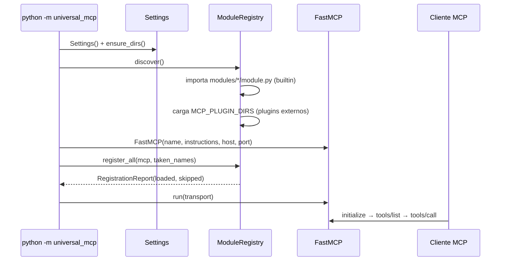

# Arquitectura de Universal MCP

## 1. Visión general

Universal MCP es un servidor **MCP (Model Context Protocol)** en Python con un
núcleo modular. El principio rector: **el servidor nunca se reescribe**; los
módulos se descubren, instalan y registran automáticamente en tiempo de arranque.

```
┌───────────────────────────────────────────────────────────┐
│                      Clientes MCP                         │
│  (Claude Desktop · IDEs · Agentes · curl / scripts)       │
└─────────────┬─────────────────────────┬───────────────────┘
              │ stdio (JSON-RPC)        │ streamable-http / sse
┌─────────────▼─────────────────────────▼───────────────────┐
│                FastMCP (SDK oficial `mcp`)                │
├───────────────────────────────────────────────────────────┤
│              UniversalMCPServer (core/server)             │
│   Settings · logging(stderr) · INSTRUCTIONS · run()       │
├───────────────────────────────────────────────────────────┤
│             ModuleRegistry (core/registry)                │
│   1. descubre builtin (modules/*/module.py)               │
│   2. descubre plugins (MCP_PLUGIN_DIRS)                   │
│   3. instancia → setup() → register(ModuleContext)        │
│   4. informe: cargados / omitidos con razón               │
├────────┬────────┬────────┬──────────┬───────┬────────────┤
│ system │ files  │ data   │ analysis │  ai   │ automation │
│ 5 tools│ 5 tools│ 5 tools│  5 tools │6 tools│  5 tools   │
└────────┴────────┴────────┴──────────┴───────┴────────────┘
```

## 2. Componentes del núcleo (`src/universal_mcp/core/`)

| Componente | Responsabilidad |
|---|---|
| `config.py` | `Settings` (pydantic-settings, prefijo `MCP_`). Listas en JSON o por comas (`NoDecode` + validador propio). |
| `base.py` | `BaseModule`: contrato `name` + `register(ctx)`; hooks `setup()`/`teardown()`. |
| `context.py` | `ModuleContext`: fachada de registro. Prefija names (`<modulo>_<tool>`) y **detecta colisiones** (`DuplicateToolError`). Expone `tool()`, `prompt()`, `resource()`. |
| `registry.py` | Descubrimiento (builtin + plugins por archivo/paquete), instanciación, aislamiento de fallos y `RegistrationReport`. |
| `server.py` | `UniversalMCPServer`: compone todo, genera `instructions` y ejecuta el transporte elegido. |
| `sandbox.py` | `resolve_in_workspace()`: garantiza que ninguna ruta escape del workspace (incluye symlinks). |
| `exceptions.py` | Jerarquía `MCPError` → las tools devuelven `{"error", "type"}` en vez de romper la sesión. |
| `logging.py` | Logging **siempre a stderr** (stdout es sagrado en stdio) + silencio selectivo de uvicorn. |

## 3. Flujo de arranque



## 4. Decisiones de diseño

### 4.1 Descubrimiento convención-sobre-configuración
- Builtin: cada subpaquete de `universal_mcp.modules` con `module.py` que
  contenga subclases de `BaseModule` definidas *en ese archivo*.
- Plugins: `*.py` sueltos o `<dir>/module.py` en `MCP_PLUGIN_DIRS`; se cargan
  con `importlib.util.spec_from_file_location` registrándolos en `sys.modules`
  (necesario para que pydantic resuelva las anotaciones de las tools).
- Un módulo roto **nunca derriba el servidor**: queda en
  `report.skipped` con su razón (`import failed`, `disabled by config`,
  `duplicate module name`, `registration failed`).
- **Sin registro parcial (v0.2)**: si `register()` falla a medias, el
  registry hace *snapshot* del estado interno de FastMCP antes de cada
  módulo y en fallo **revierte** las tools/prompts/resources añadidos
  (`remove_tool` + purga de dicts internos) y libera los nombres tomados.
  El motivo reporta `rolled back N item(s)`.

### 4.2 Namespacing de tools
Cada tool se registra como `<modulo>_<nombre>` (el prefijo lo aplica
`ModuleContext` de forma transparente). Esto:
- evita colisiones entre módulos independientes;
- hace obvio para el cliente LLM qué categoría está usando;
- se verifica en tiempo de registro (no en runtime).

### 4.2.1 Permisos por herramienta (v0.2)
`MCP_ALLOWED_TOOLS` (allowlist, vacío = todas) y `MCP_BLOCKED_TOOLS`
(denylist; **siempre gana**) aceptan globs sobre el nombre final
(`files_*`, `system_run_command`). Se aplica dos veces:
1. **Registro** — una tool no permitida no se registra y aparece en
   `RegistrationReport.blocked_tools` (el resto del módulo vive).
2. **Runtime** — las tools registradas llevan un guard que lanza
   `SecurityViolationError` si la política cambia en caliente.

### 4.2.2 Ciclo de vida (v0.2)
`setup()` corre al instanciar; `teardown()` corre en
`UniversalMCPServer.shutdown()` en **orden inverso** al de carga,
idempotente y tolerante a fallos individuales. El entrypoint CLI conecta
`shutdown()` a `SIGTERM`/`SIGHUP`/`SIGINT` y a `atexit`.

### 4.3 Transportes
Un solo núcleo, tres transportes (SDK oficial `mcp`):
- `stdio` — integración Claude Desktop / CLI (por defecto).
- `streamable-http` — HTTP moderno, sesiones vía header `mcp-session-id`, endpoint `/mcp`.
- `sse` — legado.

### 4.4 Modelo de seguridad (defensa en profundidad)

| Superficie | Mitigación |
|---|---|
| Rutas de archivo | Sandbox `workspace_dir` + `resolve()` + `relative_to` (cubre `..` y symlinks). |
| SQLite | `PRAGMA query_only` + whitelist `SELECT/WITH/PRAGMA/EXPLAIN`. |
| Evaluación matemática | AST-whitelist (sin `eval`), límites de exponente y resultado. |
| HTTP saliente | Solo http/https; resolución DNS y bloqueo de IPs privadas/loopback/reservadas/multicast (anti-SSRF); timeout acotado; cuerpo truncado. |
| Shell | Opt-in explícito (`MCP_ENABLE_SHELL=true`), timeout 1–120 s, salida recortada. |
| Secretos | `system_env_vars` enmascara claves con KEY/TOKEN/SECRET/PASS/CREDENTIAL/API. |
| Logging | 100% a stderr; stdout reservado al protocolo. |

### 4.5 Errores como datos
Las tools capturan `MCPError` y devuelven `{"error": ..., "type": ...}` para
que el LLM cliente pueda decidir (reintentar, cambiar de estrategia) sin
corromper la sesión MCP.

## 5. Estructura del proyecto

```
universal-mcp/
├── pyproject.toml              # empaquetado, deps, pytest, ruff
├── README.md
├── LICENSE (MIT)
├── .env.example                # plantilla de configuración
├── docs/
│   ├── ARCHITECTURE.md         # este documento
│   └── ADDING_MODULES.md       # guía de extensión
├── examples/plugins/hello_plugin.py
├── src/universal_mcp/
│   ├── __init__.py             # exports lazy (PEP 562)
│   ├── __main__.py             # CLI: python -m universal_mcp
│   ├── core/                   # núcleo modular (ver §2)
│   └── modules/                # módulos builtin (auto-descubiertos)
│       ├── system/  files/  data/
│       └── analysis/  ai/  automation/
└── tests/                      # pytest + pytest-asyncio (46 pruebas)
```

## 6. Estrategia de pruebas

- **Unidad**: config (env JSON/comas), sandbox (escapes relativos/absolutos/symlink),
  math-eval (inyección, potencias enormes), estadística, flatten, SQLite RO, NLP.
- **Integración**: servidor real vía FastMCP — `tools/list` (31 tools, sin duplicados)
  y `tools/call` por protocolo para cada módulo (incluye casos bloqueados).
- **Registry**: plugins externos cargan; plugins rotos y duplicados se omiten con informe.
- **Smoke de transporte** (manual/CI): handshake stdio completo y sesión
  streamable-http (`initialize → notifications/initialized → tools/list → tools/call`).

## 7. Roadmap técnico

1. `registry.reload()` — hot-reload de módulos sin reiniciar.
2. Resources/prompts builtin por módulo (ya soportados por `ModuleContext`).
3. Plugins en subprocess (aislamiento de fallos y permisos por módulo).
4. Autenticación del transporte HTTP (bearer/OAuth) y multi-tenant.
5. Telemetría: métricas por tool y trazas de ejecución.
